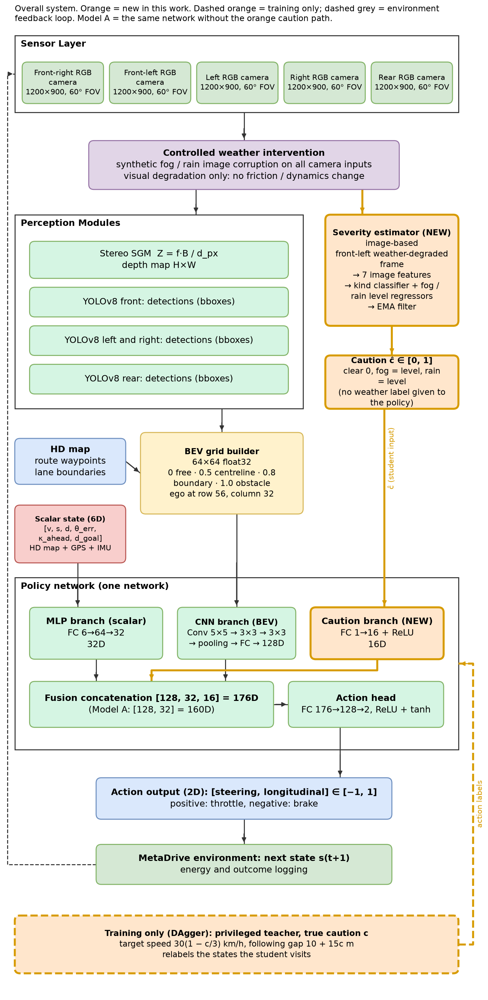
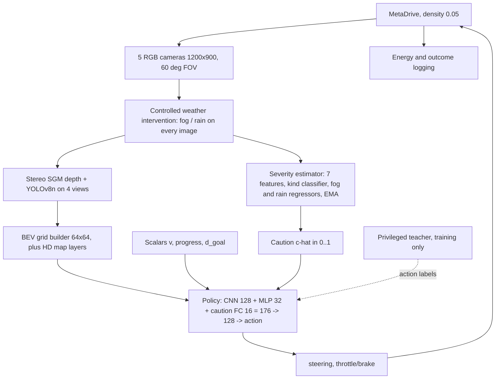

# Architecture of the final system

Colours follow `report/Architecture_Live_Caution_Branch_v2.drawio`: green = sensors and environment, purple = weather intervention, light green = perception and network, yellow = BEV builder, blue = HD map and action, red = scalar state, **orange = new in this work**, dashed = training only. Editable sources: `report/Architecture_Severity_System_v3_vertical.drawio` (page 1 overall; pages 2 to 5 are the module expansions). They are regenerated by `report/make_architecture_v3.py`.

## Modules
| Module | What it does | Code |
|---|---|---|
| Weather intervention | image-space fog (row-wise white blend, blur, noise) and rain (streaks, blur, darkening), level in [0, 1], shared stereo noise; no change to dynamics | `YOLO+weather module/weather/weather_utils.py` |
| Perception | front stereo SGM depth (Z = f B / d) and YOLOv8n on four views give object footprints | `bev_state/assembler.py`, `YOLO+weather module/` |
| BEV builder | frozen builder + HD-map layers, 64 x 64 grid, ego at row 56, column 32 | `bev_state/camera_grid_builder.py` |
| Severity estimator | 7 features of the front-left frame; softmax kind classifier; ridge level regressor per kind; EMA (alpha 0.15) on kind probability and level; identity caution map (clear 0, fog = level, rain = level) | `bev_rl/adaptive/severity_estimator.py` |
| Teacher (training only) | IDM + SafeTeacher + curve guard 4.0; target speed 30(1 - c/3) km/h, following gap 10 + 15 c m | `bev_rl/adaptive/camera_dagger_severity.py` (wrapper over `camera_dagger.py`) |
| Policy | `BEVScalarPolicy(1, 6, 1)`: CNN(BEV) 128-D, MLP(scalars) 32-D, caution FC(1->16); fusion 176-D -> 128 -> 2 | `bev_policy/model.py` |
| Energy | per-step inertial + aerodynamic + rolling traction work, no regeneration, Wh and Wh/km; unchanged | `bev_rl/energy.py` |

## Models
- **A**: the existing non-adaptive camera policy (no caution input), `results/camera_dagger_final/e2e_ov_split_final/best.pt`. Unmodified.
- **B**: the same architecture trained by camera-pipeline DAgger with the **true** caution, `results/camera_dagger_severity/e2e_sevB/best.pt`. Training reference only.
- **C**: **B's network run with the image-estimated caution** at inference (plug-in design). The student never sees a weather label or the simulator position.
